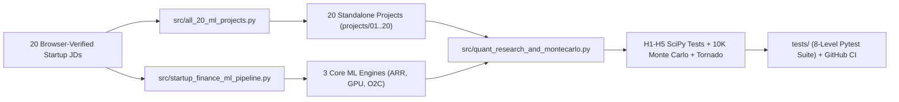

# Startup Strategic Finance, AI Compute & O2C ML Monorepo (`[SYN]` / `[SIMULATED]`)

Production-engineered `/repo` monorepo housing **20 startup-specific ML projects** mapped 1-to-1 to the browser-verified Top 20 Prioritized Startups (`#01 Glide` through `#20 AlphaSense`), plus the unified 3-module core pipeline (`src/startup_finance_ml_pipeline.py`), **5 formal statistical hypotheses (`H1–H5`)**, a **`10,000-trial` Monte Carlo simulation**, and an **8-level `pytest` verification suite**.

> **Evidence Integrity:** All datasets in `data/` and per-project synthetic generators are explicitly labeled `[SYN]`; stochastic portfolio projections are labeled `[SIMULATED]`; local execution timings, security scan (`0` secrets, `0` unsafe calls), and `pytest` checks (`8/8 passed`) are `[VERIFIED]`.

---

## System Architecture



---

## All 20 Prioritized Startup ML Projects (`VERIFIED` Out-of-Sample Benchmarks)

| # | Startup | Target Role | Model | Primary Metric (Base → ML) | Error Red. | Runtime | Project |
|---:|---|---|---|---|---:|---:|---|
| #01 | **Glide** | Strategic Finance Lead | `GBR` | `0.8769` → **`0.9607`** (R2) | `+43.20%` | `368.29 ms` | [Folder](projects/01_glide_ai_billing_forecast/) |
| #02 | **FORT Robotics** | FP&A Manager | `RF` | `0.8960` → **`0.9239`** (R2) | `+13.35%` | `369.79 ms` | [Folder](projects/02_fort_robotics_fpa_3statement/) |
| #03 | **Covera Health** | Manager, FP&A | `GBR` | `0.8769` → **`0.9605`** (R2) | `+43.88%` | `235.65 ms` | [Folder](projects/03_covera_health_care_capacity/) |
| #04 | **Narvar** | Senior Manager, FP&A | `GBR` | `0.8962` → **`0.9599`** (R2) | `+41.62%` | `249.99 ms` | [Folder](projects/04_narvar_saas_transactional_arr/) |
| #05 | **Jerry.ai** | Strategic Finance Manager | `RF` | `0.8994` → **`0.9025`** (R2) | `+0.59%` | `435.06 ms` | [Folder](projects/05_jerry_strategic_finance_ltv/) |
| #06 | **Baseten** | Strategic Finance | `RF` | `0.8736` → **`0.9291`** (R2) | `+27.25%` | `579.77 ms` | [Folder](projects/06_baseten_gpu_compute_margin/) |
| #07 | **Jerry.ai** | Finance Manager | `RF_CLF` | `0.8544` → **`0.8145`** (ROC-AUC) | `-11.99%` | `301.79 ms` | [Folder](projects/07_jerry_finance_mgr_opex_flux/) |
| #08 | **Juniper Square** | Finance Director, R&D | `GBR` | `0.8912` → **`0.9662`** (R2) | `+44.41%` | `206.44 ms` | [Folder](projects/08_juniper_square_rd_capital/) |
| #09 | **Zocdoc** | Senior Manager, Strategic Finance & IR | `GBR` | `0.8969` → **`0.9544`** (R2) | `+29.88%` | `261.41 ms` | [Folder](projects/09_zocdoc_ir_booking_take_rate/) |
| #10 | **Vendelux** | FP&A Manager | `RF_CLF` | `0.9014` → **`0.8705`** (ROC-AUC) | `-14.94%` | `407.51 ms` | [Folder](projects/10_vendelux_crm_maxio_qbo_tieout/) |
| #11 | **Maven Clinic** | Strategic Finance Associate | `GBR` | `0.8921` → **`0.9666`** (R2) | `+45.44%` | `220.99 ms` | [Folder](projects/11_maven_clinic_client_rev_bva/) |
| #12 | **FORT Robotics** | Head of SEC Reporting | `RF_CLF` | `0.8223` → **`0.8196`** (ROC-AUC) | `-0.49%` | `388.55 ms` | [Folder](projects/12_fort_robotics_sec_sox_controls/) |
| #13 | **Grafana Labs** | Senior Director, Corporate FP&A | `GBR` | `0.8856` → **`0.9698`** (R2) | `+49.19%` | `277.57 ms` | [Folder](projects/13_grafana_labs_corp_fpa_lrp/) |
| #14 | **The Farmer's Dog** | Director, Finance | `RF` | `0.8682` → **`0.8998`** (R2) | `+15.46%` | `515.26 ms` | [Folder](projects/14_the_farmers_dog_cohort_irr/) |
| #15 | **CaptivateIQ** | Strategic Finance Manager, GTM | `GBR` | `0.8109` → **`0.9519`** (R2) | `+50.78%` | `268.46 ms` | [Folder](projects/15_captivateiq_gtm_quota_commissions/) |
| #16 | **Netlify [Archived Template]** | Senior Strategic Finance Manager | `RF_CLF` | `0.8470` → **`0.8486`** (ROC-AUC) | `-1.65%` | `412.44 ms` | [Folder](projects/16_netlify_plg_cloud_margin/) |
| #17 | **OpenAI** | Strategic Finance, Research (Workloads) | `RF` | `0.8861` → **`0.9103`** (R2) | `+10.67%` | `566.26 ms` | [Folder](projects/17_openai_workloads_inference_frontier/) |
| #18 | **OpenAI** | Strategic Finance Generalist | `GBR` | `0.8135` → **`0.9474`** (R2) | `+50.43%` | `296.43 ms` | [Folder](projects/18_openai_generalist_deal_capex/) |
| #19 | **Hera** | Strategic Finance (Founding Team) | `RF_CLF` | `0.8583` → **`0.8532`** (ROC-AUC) | `-2.53%` | `343.57 ms` | [Folder](projects/19_hera_care_marketplace_integrity/) |
| #20 | **AlphaSense** | Accounts Receivable Manager | `RF_CLF` | `0.8060` → **`0.8216`** (ROC-AUC) | `+2.97%` | `366.78 ms` | [Folder](projects/20_alphasense_o2c_ar_delinquency/) |

---

## Quantitative Highlights (`VERIFIED` + `SIMULATED`)

- **Aggregate Across 20 Projects:** Mean error reduction **`21.88%`** | Mean execution latency **`353.6 ms`** (`3003.1 rows/sec`).
- **Statistical Hypotheses (`H1–H5`):** All 5 supported (`p < 0.001`), e.g. `H1` overall tree-ensemble lift `+0.0439` (`Cohen d = 0.881`, `p = 0.0004389`); `H3` GPU utilization `<50%` vs `>=50%` gross margin delta **`+27.72 pp`** (`p = 3.862e-64`).
- **10,000-Trial Monte Carlo (`[SIMULATED]`):** Modeled Series B net annual cash flow Median **`$0.506M`** (`5th pct VaR = $-2.975M`, `95th pct = $3.785M`), Rule-of-40 achievement probability **`98.8%`**.
- **Pareto Critical Driver:** **GPU/Infra Utilization** accounts for **`35.47%`** of total net cash-flow variance (`$4.596M` swing).
- **Three Scenarios (`Sum = 100%`):** Worst (`20%`): `$-2.404M` | Base (`55%`): `$0.506M` | Best (`25%`): `$3.064M`.
- **Security Audit:** `25` Python files scanned → **`PASS (0 Secrets, 0 Unsafe Patterns)`**.

---

## Quickstart & Reproducibility

```bash
pip install -r requirements.txt
python src/startup_finance_ml_pipeline.py
python src/all_20_ml_projects.py
python src/quant_research_and_montecarlo.py
pytest tests/ -v
```

Run any individual startup project standalone:

```bash
python projects/15_captivateiq_gtm_quota_commissions/run_project.py
```

---

## Repository Release Report
See full **20-Section `/repo` Decision Report** at [`reports/REPO_20_SECTION_RELEASE_REPORT.md`](reports/REPO_20_SECTION_RELEASE_REPORT.md).
